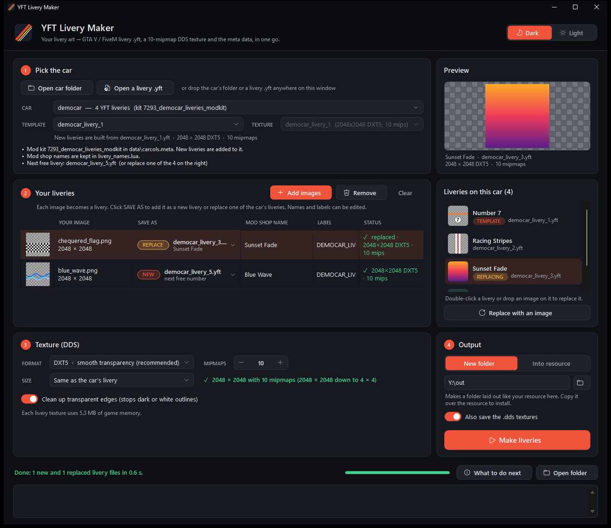
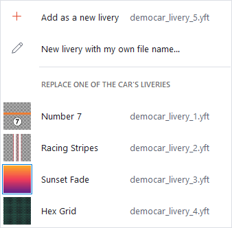

# YFT Livery Maker

Turn your livery artwork into GTA V / FiveM livery `.yft` files. Pick the car, drop in your images and press
**Make liveries**. It writes the `.yft` files, the texture as DXT5 with **10 mipmaps**, and the meta data the car
needs to show them in the mod shop.



## Download

**[Download the latest release](https://github.com/JustBlueDolphin/YftLiveryMaker/releases/latest)**: get
`YftLiveryMaker-vX.Y.Z.zip`, unzip it anywhere and run `YftLiveryMaker.exe`. There's nothing to install. It needs
.NET Framework 4.8, which Windows 10 and 11 already have.

The program isn't code-signed, so Windows may say "Windows protected your PC" the first time. Click
**More info**, then **Run anyway**.

## Making liveries

1. **Pick the car.** Click **Open car folder** and choose the car's resource (the folder with `fxmanifest.lua`), a
   whole vehicle pack or your resources folder. Every car that has YFT liveries is listed. You can also open one of
   the car's livery `.yft` files directly.
2. **Add your images.** PNG, PSD, TGA, JPG, BMP, TIFF or DDS, painted on the car's livery template.
   **Liveries on this car** lists the liveries the car already has. For each image, **Save as** picks:
   - **Add as a new livery**, with the next free number or a file name you choose.
   - **Replace** one of the car's liveries. You can also drop an image straight onto a livery in that list.
3. **Texture.** Leave it on DXT5, *Same as the car's livery*, 10 mipmaps.
4. **Output.** *New folder* makes a folder laid out like your resource, ready to copy over it. *Into resource*
   writes straight into the car's resource, and backs up every file it changes first.
5. **Restart the resource** (or the server). The liveries are in the mod shop under **Livery**.



### What it makes

- **The `.yft`:** a copy of one of the car's own livery `.yft` files with only the livery texture swapped, so the
  model, bones, shader and flags stay exactly as the car expects. A replacement is rebuilt from that livery's own
  file.
- **The texture:** DXT5 at the size of the car's livery with exactly 10 mipmaps (2048×2048 down to 4×4). Transparent
  edges are cleaned up so there are no dark outlines in game. It can save the `.dds` files too.
- **The meta data:** `VMT_LIVERY_MOD` entries in the car's `carcols.meta` mod kit, copied from the car's own
  entries, and the mod shop names in its `vehicle_names.lua` (or plain labels, if that's how the car does it).
- **`HOW_TO_INSTALL.txt` / `WHAT_CHANGED.txt`:** everything it did, file by file.

### Good to know

- **Why 10 mipmaps:** each mipmap is half the width and height of the one above, and DXT can't go below 4×4, so a
  2048×2048 texture holds exactly 10. A 1024 texture only holds 9, so keep *Size* on *Same as the car's livery*.
- Works with FiveM / legacy files and GTA V Enhanced (gen9) files. The output is the same kind as the file it copies.
- Files that start with `FXAP` are locked by FiveM Asset Escrow, and no tool can open them. Pick one of the car's
  unlocked livery files instead.
- Dark mode is the default; the switch at the top right changes it.
- The full user guide is [docs/README.txt](docs/README.txt), which is also in the zip.

### Use it from AI apps

Turn on **AI apps** at the top of the window and YFT Livery Maker adds itself to the AI apps on your PC that
support MCP: Claude Desktop, Cursor, Windsurf, VS Code and LM Studio. Restart the AI app, then just ask it, for
example:

> Make a livery for the car in `D:\server\resources\[cars]\mycar` from `C:\Users\me\Desktop\livery.png`

> Show me the liveries on my 811s2 in `D:\server\resources\[cars]`, then replace livery 3 with
> `C:\art\police.png` and call it Police

The AI app starts YFT Livery Maker in the background when it needs it, so the window doesn't have to be open.
Turning the switch off removes it again. Only YFT Livery Maker's own entry in each AI app's settings changes, and
the previous settings file is kept as `<name>.yftlivery.bak`.

AI apps start the program from where it was when you turned the switch on, so keep `YftLiveryMaker.exe` in a
folder you won't delete (not inside the zip). If you move it, turn the switch on again from the new place.

To add it by hand (the **Copy setup** button in the switch's window copies both):

- **Claude Code:** `claude mcp add --scope user yft-livery-maker -- "C:\path\to\YftLiveryMaker.exe" --mcp`
- **Any other MCP app:** add a server that runs `"C:\path\to\YftLiveryMaker.exe" --mcp` (or `yftlivery.exe mcp`):

  ```json
  {
    "mcpServers": {
      "yft-livery-maker": {
        "command": "C:\\path\\to\\YftLiveryMaker.exe",
        "args": ["--mcp"]
      }
    }
  }
  ```

The AI gets two tools:

| Tool | What it does |
| --- | --- |
| `find_cars` | Lists the cars with YFT liveries in a folder, with each car's liveries, mod shop names and the next free livery name |
| `make_liveries` | Makes liveries from images, new or replacing, the same way as the window: a new folder by default, or straight into the resource with backups |

Writing straight into a car's resource first shows a Yes/No box on your PC, so an AI can't change your server
files without you; the default (a new folder) needs no click. For unattended automation only, setting the
environment variable `YFTLIVERY_NO_CONFIRM=1` for the server skips the box. Only do that if you accept the risk.

It runs on your PC over stdin/stdout and opens no network port. Like anything else in the chat, what the tools
return (car names, file paths) goes to the AI service your app uses.

### Command line

`yftlivery.exe` in the zip does the same job in batch. Run it with no arguments to see every option.

```
yftlivery scan "D:\server\resources\[cars]\my_pack"
yftlivery make "D:\server\resources\[cars]\my_pack" art1.png art2.png --car mycar --out D:\out
yftlivery make ... --replace mycar_livery_3=art3.png --install
```

## Building from source

You need Windows, git and any .NET SDK 6 or newer ([dot.net](https://dot.net)).

```powershell
git clone --recursive https://github.com/JustBlueDolphin/YftLiveryMaker.git
cd YftLiveryMaker
powershell -ExecutionPolicy Bypass -File build.ps1
```

`build.ps1` fetches CodeWalker if it's missing, builds both programs, runs the self-tests, and puts
`YftLiveryMaker.exe`, `yftlivery.exe` and the release zip in `dist\`.

| Path | What |
| --- | --- |
| `src/LiveryKit` | The engine: image readers (WIC, TGA, PSD, DDS), resizer, mip chain, BC1/BC3/BC7 encoders and decoders, DDS writer, YFT builder with self-check, car scanner, `carcols.meta` and names patchers |
| `src/YftLiveryMaker` | The Windows app |
| `src/LiveryCli` | The command-line tool |
| `src/Shared` | Start-up code that makes each `.exe` a single file |
| `tests` | MCP smoke test, run by `build.ps1` when Python is installed, plus a manual end-to-end script for real cars |
| `third_party/CodeWalker` | [CodeWalker](https://github.com/dexyfex/CodeWalker) as a git submodule, used to read and write `.yft` files |

### Making a release

1. Bump `<Version>` in `src/YftLiveryMaker/YftLiveryMaker.csproj`.
2. Run `build.ps1`, then commit and push.
3. Publish the zip with the [GitHub CLI](https://cli.github.com):

   ```powershell
   gh release create v1.1.0 dist\YftLiveryMaker-v1.1.0.zip --title "YFT Livery Maker 1.1.0" --notes "What changed"
   ```

   Or on GitHub: **Releases**, **Draft a new release**, then attach the zip.

## How the output is checked

- **Every `.yft`** is reopened after it's written and compared with the file it was copied from. The texture must be
  the new one, every shader slot must point at it, and everything else must be unchanged: models, vertex and index
  data, bones, shader parameters and other textures. If any check fails, nothing is written for that livery.
- **Textures:** every mipmap level was decoded with Pillow's independent decoders and compared with the source. DXT5
  scores 41–55 dB on the levels you see in game, ahead of Pillow's own encoder at every level.
- **Meta files:** the `carcols.meta` and `vehicle_names.lua` edits are pure insertions in the file's own style,
  checked against the originals and with XML validation. Self-tests cover CRLF, BOM, comments, empty kits, quoting,
  renames and re-runs (`yftlivery selftest`).

## Licensing

**This project's own code** is under the [MIT licence](LICENSE). You can use, change and share it, including in paid
work, as long as the copyright notice and licence text go with it.

**Third-party parts** keep their own terms. The full notices are in
[THIRD-PARTY-NOTICES.txt](THIRD-PARTY-NOTICES.txt), which is also in every release zip.

| Part | Used for | Licence |
| --- | --- | --- |
| [CodeWalker.Core](https://github.com/dexyfex/CodeWalker) by dexyfex | Reading and writing `.yft` files | No licence published (see below) |
| Code inside CodeWalker.Core by Neodymium and Cameron Berry | Part of CodeWalker.Core | MIT |
| [SharpDX](https://github.com/sharpdx/SharpDX) 4.2.0 | Used by CodeWalker.Core | MIT |
| [DirectXTex](https://github.com/microsoft/DirectXTex) by Microsoft | The BC7 tables in `src/LiveryKit/Textures/Bc7Tables.g.cs` | MIT |

How CodeWalker is handled:

- **No copy of its source here.** `third_party/CodeWalker` is a git submodule that points at the official
  repository, pinned to one commit, and it's built unmodified.
- **No GPL code.** CodeWalker.Core contains an FBX importer with GPL code (Hamish Milne's FbxWriter). This tool
  doesn't use it, so [`third_party/Directory.Build.targets`](third_party/Directory.Build.targets) leaves those two
  files out of the build. Nothing GPL is in this repository or in the release files, so the MIT licence above isn't
  affected.
- **Credit for dexyfex's code.** dexyfex's own code has a copyright notice but no licence. The release `.exe` files
  include CodeWalker.Core with full credit. If you're dexyfex and would like this handled differently, please open
  an issue.

**Your liveries and cars:** your artwork stays yours. The livery files it makes contain a copy of the car's own
livery model, which belongs to the car's author. Only use the tool on cars you have the rights to modify, and follow
the car's terms (for example, don't share paid cars). It can't open FiveM Asset Escrow files and doesn't try to.

Grand Theft Auto and GTA are trademarks of Take-Two Interactive Software. This project is not affiliated with or
endorsed by Rockstar Games, Take-Two Interactive or Cfx.re (FiveM).
